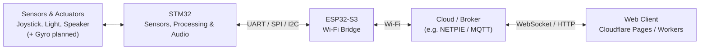

# ambad

Final project for **Embedded System Lab (Fall 2026)** — an IoT device built with an **STM32** microcontroller, an **ESP32-S3** Wi-Fi bridge, a cloud messaging layer, and a web client.

---

## Architecture

## How Data Flows

- **Device → Web:** The STM32 reads sensor inputs, handles basic local processing (filtering, scaling, debouncing), and sends the state to the ESP32-S3. The ESP32-S3 forwards it over Wi-Fi to the cloud broker, which pushes live updates to the web client.
- **Web → Device:** User actions or events on the web client send commands back through the cloud to the ESP32-S3, which relays them to the STM32 to drive outputs such as the speaker/buzzer.

---

## Hardware Overview

| Part | Interface | Role |
| :--- | :--- | :--- |
| **Joystick** | 2× ADC + GPIO (`SW`) | 2-axis analog input and push button |
| **Light Sensor** | ADC (or I2C) | Ambient light sensing / input trigger |
| **Speaker / Buzzer** | PWM (+ driver if passive) | Local audio feedback |
| **Gyro / IMU *(Planned)*** | I2C | Motion and orientation sensing |
| **STM32 ↔ ESP32-S3** | UART (3.3V + common `GND`) | Bidirectional data and command link |

---

## Project Structure

Details and setup notes for each part are in their respective `README.md`:

- **[`stm32-firmware/`](stm32-firmware/README.md)** — STM32CubeIDE project for sensor acquisition, local processing, and actuator control.
- **[`esp32-bridge/`](esp32-bridge/README.md)** — ESP32-S3 firmware bridging serial data from the STM32 to Wi-Fi and the cloud.
- **[`web-client/`](web-client/README.md)** — Client-side web UI and deployment setup (planned on Cloudflare Pages / Workers).
