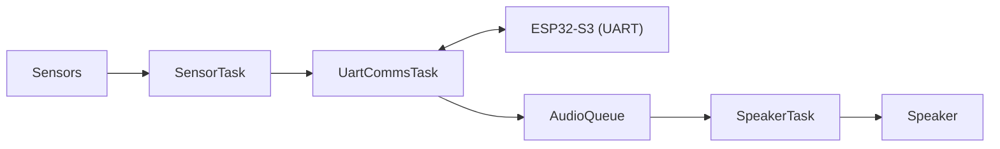

# STM32 Firmware

Firmware for the **STM32 Nucleo-F401RE** (`STM32F401RE`) built with **STM32CubeIDE**, HAL drivers, and **FreeRTOS (`CMSIS_V2`)**.

---

## Configuration Overview

- **MCU / Board:** STM32F401RE (Nucleo-F401RE)
- **RTOS:** FreeRTOS (`CMSIS_V2`)
- **HAL Timebase Source:** `TIM11` *(separated from `SysTick` used by FreeRTOS)*

---

## FreeRTOS Tasks & Queues

| Name | Type | Priority | Stack (Words) | Role |
| :--- | :--- | :--- | :--- | :--- |
| `HeartbeatTask` | Task | `osPriorityLow` | 128 | **Active** — Toggles onboard `LD2` (`PA5`) every 500 ms |
| `SensorTask` | Task | `osPriorityNormal` | 256 | *Planned* — Read inputs and run local processing |
| `UartCommsTask` | Task | `osPriorityNormal` | 512 | *Planned* — Handle UART TX/RX with the ESP32-S3 |
| `SpeakerTask` | Task | `osPriorityBelowNormal` | 256 | *Planned* — Wait on `AudioQueue` and drive PWM output |
| `AudioQueue` | Queue | — | 8 × `uint8_t` | *Planned* — Buffers sound commands for `SpeakerTask` |

---

## Runtime Flow

1. **Uplink:** `SensorTask` reads and processes sensor inputs, and `UartCommsTask` sends the latest state to the ESP32-S3 over UART.
2. **Downlink:** `UartCommsTask` receives commands from the ESP32-S3 and pushes a sound ID into `AudioQueue`.
3. **Audio:** `SpeakerTask` waits on `AudioQueue` and plays audio on the speaker/buzzer without blocking sensor reads or UART.
4. **Heartbeat:** `HeartbeatTask` blinks `LD2` every 500 ms independently as a live status check.