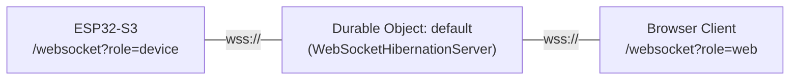

# Web Client & WebSocket Hub

Interactive web client and Cloudflare Durable Object WebSocket relay for `ambad`, built with **Vite + Vue 3 (TypeScript)** and **Cloudflare Workers**.

---

## Tech Stack

- **Frontend:** Vite + Vue 3 (TypeScript), Vue Router, `@vueuse/core`
- **Backend / Relay:** Cloudflare Workers + Durable Objects (`WebSocketHibernationServer` in `server/index.ts`)
- **CLI / Package Manager:** `pnpm` + `wrangler` (`@cloudflare/vite-plugin`)

---

## Structure

```text
web-client/
├── wrangler.jsonc                   # Worker & Durable Object config ("new_sqlite_classes")
├── server/
│   └── index.ts                     # Worker entrypoint (/websocket) + WebSocketHibernationServer DO
└── src/
    ├── assets/main.css              # Base global styles
    ├── composables/useDeviceSocket.ts # Browser WebSocket client (via VueUse)
    ├── router/index.ts              # Vue Router routes
    ├── views/HomeView.vue           # Main page / WebSocket test view
    ├── App.vue
    └── main.ts
```

---

## How the WebSocket Hub Works (`server/index.ts`)



- **Single Shared Room:** All `/websocket` requests route to `env.WEBSOCKET_HIBERNATION_SERVER.getByName("default")` (automatically created on first request).
- **Role-Based Forwarding:** Connections tag themselves via `?role=device` or `?role=web`.
  - Messages from `device` are forwarded only to `web` clients.
  - Messages from `web` are forwarded only to `device` clients.
- **Hibernation & Keep-Alive:**
  - Uses `this.ctx.acceptWebSocket()` so the Durable Object sleeps after ~10s of inactivity (`0` compute usage) while keeping connections open at the edge.
  - Connection metadata (`id`, `role`) is saved with `serializeAttachment()` and restored in `constructor()` when waking up.
  - Sending `"ping"` returns `"pong"` via `setWebSocketAutoResponse` without waking the Durable Object.
- **Persistence Ready:** Declared with `new_sqlite_classes` in `wrangler.jsonc`, so `this.ctx.storage.sql` is ready to store scores, logs, or settings later without adding an external database.

---

## Extending Into a Game or Interactive App

- **Rendering (2D / 3D):** Add an HTML5 `<canvas>` (`requestAnimationFrame`), **Phaser 3** / **PixiJS** (2D), or **Three.js** (3D) inside a view while Vue manages UI overlays (menus, scores, status).
- **Multi-Page Views:** Use `vue-router` to add extra routes later (e.g., `/debug` for live sensor telemetry and speaker testing).
- **Cloud Persistence (Optional):** Use `this.ctx.storage.sql` in `WebSocketHibernationServer` if you need persistent scores, session logs, or device settings.

---

## Commands

```bash
pnpm run dev             # Start local dev server (localhost:5173)
pnpm run dev -- --host   # Expose on local LAN (for ESP32 local testing)
pnpm run build           # Type-check (vue-tsc) and build production bundle
pnpm run cf-typegen      # Regenerate worker Env types after editing wrangler.jsonc
pnpm run deploy          # Build and deploy to Cloudflare Workers
```